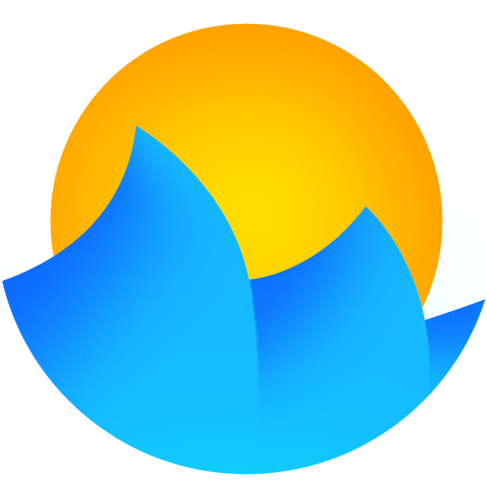

# FluidGL

Real-time 3D fluid and smoke simulation, written from scratch in C++ and OpenGL compute shaders. The whole simulation pipeline runs on the GPU.

## Features

- [x] **PIC/FLIP solver** with RK2 particle advection

- [x] **Pressure projection** with a hand-written MGPCG
- [x] Particles are **sorted every frame** with a counting sort built on a parallel prefix sum, so neighbour lookup is constant time for P2G (particle to grid), particle separation and diffusion.
- [x] **Liquids**: Collisions against SDF
- [x] **Smoke**: Temperature and density carried by the particles, buoyancy, cooling, vorticity confinement, and diffusion between neighbouring particles
- [x] **Open or closed** domain boundaries, with particle recycling and reseeding
- [x] **Live editing** of scenes and solver parameters through a Dear ImGui interface
- [x] **Profiling**: a GPU timer per stage (sort, P2G, pressure solve, G2P) is displayed in the app.

## Perfs


## Build and run

You need CMake 3.30+, a C++20 compiler, OpenMP, and a GPU and driver with OpenGL 4.3+. Dependencies are fetched by CMake.

```bash
git clone https://github.com/SlyZ1/fluidgl.git
cd fluidgl
cmake -B build
cmake --build build -j
./myprogram
```

On Linux, `./start.sh` rebuilds and runs through `prime-run`, which forces the discrete GPU on hybrid NVIDIA laptops. On a single-GPU machine, run `./myprogram` directly.

## Built with

[GLFW](https://www.glfw.org/), [glad](https://glad.dav1d.de/), [GLM](https://github.com/g-truc/glm), [Dear ImGui](https://github.com/ocornut/imgui) and [nativefiledialog-extended](https://github.com/btzy/nativefiledialog-extended). Licensed under Apache 2.0, see [LICENSE](LICENSE).